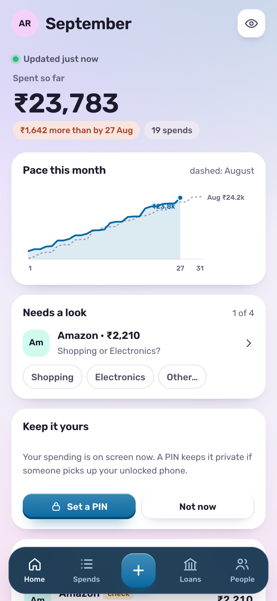
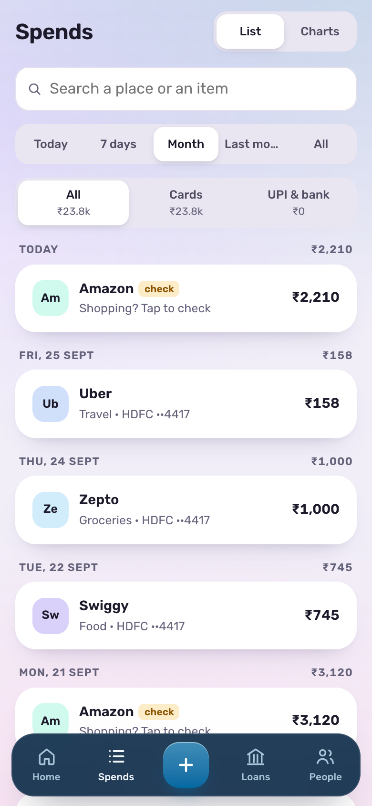
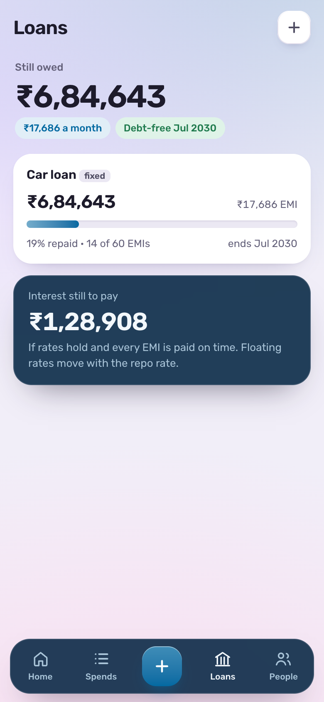
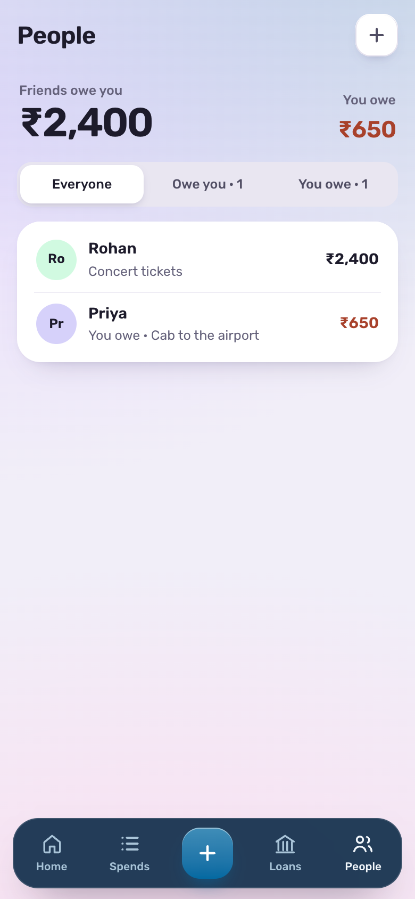
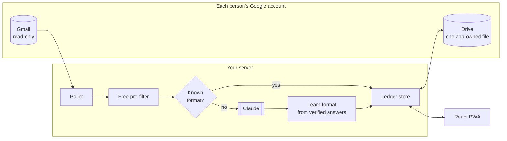

# Expense Tracker

Your bank already emails you about every card and UPI spend. This app reads
those alerts from Gmail, uses Claude to pull out the amount, merchant and
category, and keeps one ledger (spends, IOUs with friends, and loans) on **your
own computer**, or in **your own Google Drive**. Self-hosted, for you and your
household.

<p>
  
  
  
  
</p>

**Watch it:** [a walkthrough under a minute long](site/media/demo.mp4), from a
fresh install set up in the browser to spends, IOUs, loans and inviting the
household (made-up data; `npm run video` records it again).

**Try it without an account:** `npm run demo`, then open <http://localhost:8080>.
The demo runs the real app against fake Gmail, Drive and Claude, and gives each
visitor a private sandbox with six weeks of made-up bank alerts. It needs no
API keys and no Google account.

## What it does

- **Spends appear on their own.** Card and UPI alerts from any bank, checked
  every 10 minutes. A new account starts with everything since the 1st of last
  month.
- **It learns your banks' formats.** After a bank's alert has been read the
  same way a few times, the app reads that layout itself and stops paying the
  model for it.
- **It asks when unsure.** An Amazon charge with no item names gets a one-tap
  "Shopping or Electronics?" instead of a silent guess, and your answers become
  rules.
- **Splits and IOUs.** One balance per person, however it came about.
- **Loans that add up.** Outstanding balance, EMIs left, the date you'll be
  debt-free, and what closing early would save.
- **Statements, on demand.** Import a password-protected bank statement PDF for
  UPI spends the alerts missed. The password is used once and never stored.
- **Private by default.** An optional PIN locks the app on a shared phone, and
  amounts can be masked on screen.

## How it works



- **The server stores almost nothing.** Per account: the Google id, email, name,
  an encrypted refresh token and timestamps. Transactions, rules, loans, IOUs
  and the PIN hash live in that person's Drive file, which the app can reach
  only through the `drive.file` scope, so it can't see anything else in Drive.
  On the simple path (`MAIL_ACCESS=app-password`) the same file is kept on the
  server's disk instead, and the encrypted secret is a Gmail app password.
- **One mailbox interface, two transports.** `server/gmail/imap.js` reads Gmail
  over IMAP and returns messages in the Gmail API's own shape. Gmail's IMAP
  extensions make it exact: `X-GM-RAW` takes the API's search syntax unchanged,
  and `X-GM-MSGID` is the API's message id in decimal, so everything downstream
  (alert parsing, DKIM checks, statement import) is shared.
- **Sign-in is the permission grant.** One Google consent covers identity,
  `gmail.readonly` and `drive.file`. The refresh token is encrypted with
  AES-256-GCM and bound to the account id, so a token copied onto another record
  won't decrypt.
- **Every request runs as one account.** `requireAuth` resolves the session and
  runs the rest of the request inside that account's `AsyncLocalStorage`
  context (`server/context.js`). The store, the Google client and the
  per-account write queues all read the account from there and throw if there
  is none, so no route can reach another household member's data by passing
  the wrong id.
- **One poll serves every account**, a few at a time: from Cloud Scheduler on
  Cloud Run, or a built-in timer on a server or Docker host.

## Engineering notes

Some decisions worth reading the code for:

**Learned templates instead of generated code** (`server/templates/`). The
obvious way to cut model costs is to ask Claude to write a parser for each bank.
That means executing model-written code on text an attacker can email you. So
instead, templates are *induced* on the server from Claude's verified answers:
token alignment (LCS) of two alerts from the same DKIM-verified sender. A
template must agree with Claude five times before it goes live, is then
spot-checked 1 time in 50, and is retired on the first disagreement. Nothing
generated is ever executed.

**Structured output without structured outputs** (`server/llm/client.js`).
Bedrock has no structured-output mode, so JSON comes back through one forced
tool call whose input schema is the shape wanted. Both providers use the same
path, so switching `AI_PROVIDER` between Anthropic's API and Amazon Bedrock
can't change what the model returns. Only the configured provider's SDK is ever
loaded, and the welcome screen and privacy page name whichever is in use.

**Timezones that don't lose a day** (`server/utils/datetime.js`). "Since the 1st
of last month" means midnight in the app's timezone, not UTC. In India, UTC
midnight is 05:30, which silently dropped every alert from the first five and a
half hours of the month until the window was computed from zone offsets.

**Fakes at the edges, not mocks in the middle** (`e2e/`). The end-to-end suites
run the real server, with its routes, stores, learning and billing, in-process.
Only the outside world is replaced: Google sign-in, Gmail and Drive; Claude;
Razorpay's HTTP API. Any other network call throws. The same fakes power the
public demo.

**Privacy-preserving format sharing** (`server/templates/library.js`, optional).
For a public multi-tenant deployment, a bank format can be shared once
*k* independent accounts (default 3) learn exactly the same scrubbed form.
Until then the server keeps only keyed hashes. See
[docs/hosted-mode.md](docs/hosted-mode.md).

## Run your own

Two steps: start it somewhere, then set it up in the browser.

**1. Start it.** With [Docker Desktop](https://www.docker.com/products/docker-desktop/)
installed, download this repository, open a terminal in its folder, and run:

```bash
./setup.sh
```

It asks nothing. It starts the app at <http://localhost:8080> and prints a
one-time setup code. (On Windows: `docker compose up -d --build`, then
`docker compose logs app` shows the code.)

**2. Set it up in the browser.** Open the address and the first-run screen asks
for three things:

1. the **setup code**, which proves you're the one who started it;
2. your **Claude API key**, checked with Anthropic on the spot;
3. your **Gmail**: your address and an app password, which the screen shows you
   how to make in about a minute (no Google Cloud project needed).

You're the owner. Invite your household from **You → Household**: each invite is
a one-time link they open on their phone to connect their own Gmail. Everyone
sees only their own spends. Statement passwords are remembered per person if they
tick "Remember" when adding UPI spends.

**Host it wherever you like.** It's one container that keeps everything in one
folder (`/data`), so anything that runs a container with a disk will do: your
computer, a home server or NAS, a VPS, or a container host. For a free `https://`
address on Google Cloud, run [`scripts/deploy-cloud-run.sh`](scripts/deploy-cloud-run.sh)
from Google Cloud Shell: it creates the project, a private storage bucket as the
data folder, the Cloud Run service and the 10-minute email check, then prints the
address and setup code. **You → Household → Back up everything** saves it all in
one passphrase-locked file; a new install's first screen restores it, which is
also how you move between hosts.

| | **Simple** (default) | **Google sign-in** (`npm run setup:google`) |
|---|---|---|
| Setup | The first-run screen in the browser | A terminal wizard, plus four Google Cloud pages it opens for you |
| Each person, once | Makes a Gmail app password (the app shows how) | Signs in with Google |
| Gmail access | Full mailbox over IMAP; the app only ever searches for bank mail | Read-only (`gmail.readonly`) |
| Ledgers | In the data folder, with one-file backups | A file in each person's Google Drive |

[docs/self-hosting.md](docs/self-hosting.md) has every step in more detail.

For development:

```bash
npm install && npm --prefix web install
npm --prefix web run build
npm run dev              # server on :8080
cd web && npm run dev    # hot-reloading frontend on :5173, /api proxied to :8080
```

## Tests

```bash
npm test          # unit: 152 tests
npm run test:e2e  # end to end: 45 scenarios across five suites
```

| Suite | Configuration | Covers |
|---|---|---|
| `test/` | Unit | Token encryption, session signing, tenant isolation under interleaved writes, template induction and retirement, statement layouts, transfer rules and cross-sender duplicates, billing entitlement, config guards, the Google sign-in wizard, IMAP messages in the Gmail API's shape, the catch-up window and retries, install settings, invites and remembered statement passwords |
| `e2e/app-password.e2e.test.js` | Simple path from a fresh install: Gmail over IMAP, ledgers in the data folder | The first-run screen (setup code, Claude key, owner), invites and removing people, first sync matching the API path, catching up after days offline and in batches, a removed app password pausing the account, guessing cut off before Gmail, the encrypted backup |
| `e2e/restore.e2e.test.js` | A fresh install restoring a backup from elsewhere | Wrong code, passphrase or file refused; accounts, ledgers, settings and saved Gmail access working straight away |
| `e2e/selfhost.e2e.test.js` | Self-hosted default | Allowlist, no trial or paywall, formats never shared, polling every account |
| `e2e/app.e2e.test.js` | Every optional feature on | Sign-up, the first-sync window, learning, shared formats, pull to refresh, trial, paywall, Razorpay checkout and webhooks, PIN, revoked Google access, account deletion |
| `e2e/demo.e2e.test.js` | The public demo | Sandboxed visitors who can't see or lock each other |

GitHub Actions runs both, plus the Docker builds, on every push.

## Project layout

```
server/
  index.js            routes and security headers
  config.js           every setting, and the checks that stop an unsafe start
  context.js          per-request account context (AsyncLocalStorage)
  poll.js             reads new alerts for the current account
  gmail/  llm/        fetching, pre-filtering and extracting alerts
  templates/          learned alert formats and statement layouts
  drive/store.js      the ledger: cached, write-through to Drive, per-account queues
  auth/  users/       Google sign-in, sessions, PIN, encrypted account records
  billing/  legal/    optional: payments and policy pages for a public deployment
web/src/              React PWA
e2e/                  fakes, end-to-end suites, local mock and the public demo
docs/                 self-hosting, hosted mode, screenshots
```

## Limits

- **One instance.** Each ledger's writes are serialised in memory, so run a
  single instance (`--max-instances=1` on Cloud Run) until there's a
  distributed lock.
- **India first.** Amounts are in rupees with Indian digit grouping, one
  timezone per install, and the bank domain list and statement parsers lean
  Indian. Other banks' alerts still go to Claude.
- **Unverified Google app.** A Google sign-in install uses your own OAuth app,
  so you'll see Google's "unverified app" warning. Publish it (see the
  self-hosting guide) or sign-ins expire after 7 days.
- **App passwords are broad.** The simple path needs 2-Step Verification on the
  Google account, and an app password opens the whole mailbox, not just reading
  it. The app only searches for bank mail, keeps the password encrypted like a
  refresh token, and pauses the account if it stops working; removing it in the
  Google account ends access. Some work and school accounts don't allow them.

## Licence

[MIT](LICENSE)
